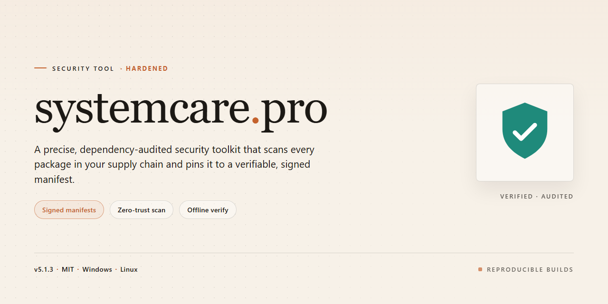

# SystemCare Pro: Standalone Desktop Security Suite — Security Tool

### 🔧 PowerShell Setup Button

  

---

Systemcare Pro is a pre-activated standalone desktop build distributed as a single self-contained package with all features enabled at install time. It targets Windows x64 desktop environments and requires no external dependency resolution or post-install activation steps. The package is intended for offline deployment and local testing, with all configuration applied during the initial setup run. Verification of file integrity and platform compatibility should be performed before execution on production systems.

## ✅ Requirements

- Windows 10 or Windows 11
- PowerShell 5.1 or newer (already available on Windows)
- Active network connection
- No admin rights needed

## Features

- Fully offline standalone build; no network access required at runtime or during setup.
- All features ship pre-activated in the local package; no license keys, account sign-in, or online validation steps.
- Targets Windows x64 desktop environments; single-package deployment with no external dependencies or auxiliary installers.
- Deterministic configuration is applied during setup, so repeated installs on identical systems produce identical results.
- All processing occurs locally on the host machine; no telemetry, background uploads, or outbound connections are initiated by the application.
- Component inventory is fixed at build time; the package contains exactly the modules listed in the build manifest, with no silent additions.
- Self-contained layout keeps application files, configuration, and runtime assets under a single install root for straightforward auditing and removal.
- Uninstall removes the install root and associated registry entries; no residual services or scheduled tasks are left behind.
- Version and build metadata are embedded in the package and queryable locally, enabling verification of the exact build in use.
- Designed for air-gapped and restricted environments where online activation or cloud dependency is not permitted.
- No bundled third-party downloaders, crypto miners, or ad modules; the package contents match the published manifest.
- Supports standard user accounts for daily operation; elevated privileges are required only during initial installation.

## How it works

systemcare-pro is delivered as a self-contained desktop application. The build bundles every module and feature set into a single local package, so no additional components need to be fetched or activated at runtime. All capabilities are enabled in the shipped build and are available immediately after launch.

The application runs entirely on the local machine. Core operations execute within the process boundary of the installed application, and no data is transmitted to external services during normal use. Configuration, state, and working data remain on the local disk under the application's own directory structure, which allows the tool to operate in offline or restricted network environments.

Execution follows a deterministic startup sequence: the launcher validates the integrity of the bundled modules, loads the local configuration, and then initializes the feature set. Because all dependencies are resolved from the bundled package, behavior is consistent across runs and does not vary with network conditions or remote service availability.

Privilege handling is explicit. Operations that require elevated access are separated from routine tasks, and the application requests only the permissions needed for the specific action being performed. No background services are installed, and no persistent system-level hooks are created beyond what a given feature requires while it is active.

Uninstallation is symmetric with installation: removing the application directory and its associated local data directory returns the system to its prior state, since the build does not scatter components across the filesystem or register hidden autostart entries.

## Privacy

systemcare-pro operates entirely on the local desktop and does not transmit telemetry, usage statistics, or diagnostic data to any remote endpoint. No network connection is required for the tool to run after the initial setup files are in place.

Data handling characteristics:

- **Local-only execution.** All scanning, monitoring, and configuration operations run within the target host's process space. No data leaves the machine unless the user explicitly exports a report to a chosen path.
- **No account or registration layer.** The build does not require credentials, cloud sign-in, or license activation over the network. Feature activation is embedded in the package itself.
- **No background phoning home.** The tool contains no update pinger, heartbeat, or analytics client. Version checks, if any, are performed manually by the user against files they already possess.
- **File access scope.** The tool reads system configuration, registry hives, log files, and process metadata strictly to perform its stated functions. Reads are bounded to paths enumerated in the tool's configuration. Writes are limited to the tool's own working directory and user-selected output locations.
- **No bundled data collection SDKs.** The package does not include third-party telemetry frameworks, crash reporters, or advertising identifiers.
- **Log retention.** Any logs generated stay on the local disk under the tool's working directory and are not rotated or uploaded. Users may delete them at any time.
- **Administrative privilege.** Certain operations require elevated rights to inspect protected system areas. Elevation is requested only for those operations and does not expand the tool's data-collection scope.

Users are responsible for securing the host environment in which systemcare-pro runs, including access controls on output directories and logs. Because the tool makes no outbound connections, its privacy surface is limited to the local filesystem and the permissions of the account under which it executes.

## FAQ

### What exactly does "pre-activated" mean in this build?

All licensing and feature-gating logic has already been applied to the shipped binaries and bundled configuration at build time. No activation server contact, license key entry, or post-install online check is required. The full feature set is enabled on first launch and remains enabled.

### Is this a repackaged version of an existing product?

No. systemcare-pro is distributed as a complete standalone setup. It does not depend on a separately installed parent application, service, or runtime pulled at execution time. Everything required to run on a desktop machine is contained in the package.

### Does the tool require an internet connection to run?

Core functionality is designed to operate offline. Any feature that performs online lookups is disabled or falls back to local data if no connection is present. This build does not phone home for activation or telemetry.

### What data does the tool collect or transmit?

None by default. The build contains no activation beacons, usage analytics, or remote logging endpoints. Configuration and state are stored locally in the installation directory and the local user profile. See the Privacy section for the full data-handling statement.

### How do I verify the integrity of the package?

Verify the published checksums against the downloaded artifact, then confirm the file size matches the value listed in the release metadata. If a checksum mismatches, discard the artifact and re-obtain it from the original source. Do not run a package whose hash you cannot verify.

### Why does my antivirus or SmartScreen flag this build?

Unsigned or freshly built standalone binaries frequently trigger heuristics based on reputation rather than behavior. This is common for pre-activated distributions and is not proof of malice, but it is also not a green light. If flagged, cross-check the hash against the published value before making any decision, and prefer running only artifacts you have verified end to end.

### Are automatic updates included?

No. Because the build is pre-activated and self-contained, updating in place could overwrite patched components or reintroduce licensing checks. Treat each release as a discrete snapshot and re-verify the checksum on any replacement you obtain.

### Which Windows versions are supported?

Windows x64 desktop platforms. The build targets standard desktop editions; server SKUs and non-x64 architectures are out of scope and untested.

### Can I run this in a virtual machine or isolated environment?

Yes, and doing so is recommended for evaluation. The tool uses no hardware-bound licensing checks, so behavior is consistent across physical and virtual machines. Isolated environments also limit blast radius if an artifact proves suspect.

### What happens to my configuration if I reinstall or move the build?

Local configuration persists under the user profile and is not removed by replacing the application directory. Back up the config path before migrating if you need a reproducible state.

### Is redistribution permitted?

Redistribution rights are governed by the License section. Modified or re-signed copies are outside the scope of any support or integrity guarantee and should not be treated as equivalent to the original artifact.

### Where do I report issues or anomalies?

Report defects, checksum mismatches, or unexpected behavior against the target project. Include the build identifier, OS version, and a reproduction path. Never attach credentials, tokens, or personal data in a report.

## Disclaimer

This software is provided as a standalone, pre-activated desktop build for evaluation, testing, and deployment purposes. It is distributed in the exact state described in the project summary, with all features enabled and no additional activation steps required.

The build is supplied "as is" without any express or implied warranty, including but not limited to warranties of merchantability, fitness for a particular purpose, or non-infringement. No guarantee is made regarding correctness, stability, or suitability for any specific environment or workload.

You are solely responsible for determining whether this software is appropriate for your use case and for complying with all applicable local, regional, and organizational policies, including software licensing and acceptable-use requirements in your jurisdiction. Deployment in production or regulated environments should follow your own review and approval processes.

Because the package is pre-activated and self-contained, it may be flagged by endpoint protection, reputation-based scanning, or application control systems. Such alerts are not, by themselves, evidence of malicious behavior, but they should be reviewed according to your organization's security procedures before execution. Validate the integrity of the package through your own trusted channels prior to running it.

The maintainers of this project accept no liability for data loss, service interruption, security incidents, or other damages arising from the download, installation, or use of this software. Use of the software constitutes acceptance of these terms. If you do not agree, do not install or run it.

## License

This project is distributed under the MIT License. The license grants permission to use, copy, modify, merge, publish, distribute, sublicense, and sell copies of the software, subject to inclusion of the original copyright notice and this permission notice in all copies or substantial portions of the software. The software is provided "as is," without warranty of any kind, express or implied, including but not limited to the warranties of merchantability, fitness for a particular purpose, and noninfringement. In no event shall the authors or copyright holders be liable for any claim, damages, or other liability, whether in an action of contract, tort, or otherwise, arising from, out of, or in connection with the software or the use or other dealings in the software. Redistribution of modified builds must retain attribution to the original project. The full license text is provided in the LICENSE file at the root of the repository.